# Support de téléphone en découpe laser (SolidWorks, MDF)

🇫🇷 [Français](#français) · 🇬🇧 [English](#english)

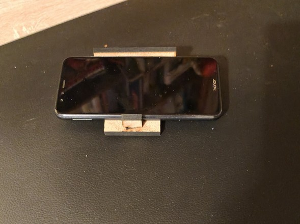

---

## Français

### Le besoin
Projet de **1re STI2D** (innovation technologique, novembre 2021). Il s'agit de concevoir un **support simple pour smartphone**, qui permette de regarder l'écran posé sur un bureau, avec une bonne inclinaison, sans que le téléphone glisse ou tombe. Le support doit être stable et soigné. Contraintes :
- 2 pièces au minimum et 3 au maximum, **sans vis, sans colle et sans pliage** : les pièces s'emboîtent ;
- pièces planes obtenues par **découpe laser**, dans du **MDF ou du PMMA de 3 ou 4 mm** ;
- encombrement maximal 80 × 50 mm, hauteur 50 mm, masse maximale 15 g ;
- conception sous **SolidWorks**.

Critères que je me suis fixés pour choisir entre mes solutions : stabilité, taille, esthétique, solidité dans le temps, démontage facile, transport, bonne inclinaison, téléphone bien maintenu, écran et haut-parleur dégagés.

### Conception

| Croquis 1 | Croquis 2 |
|---|---|
| 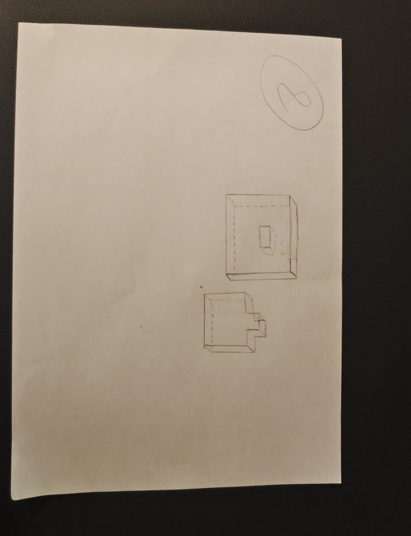 | 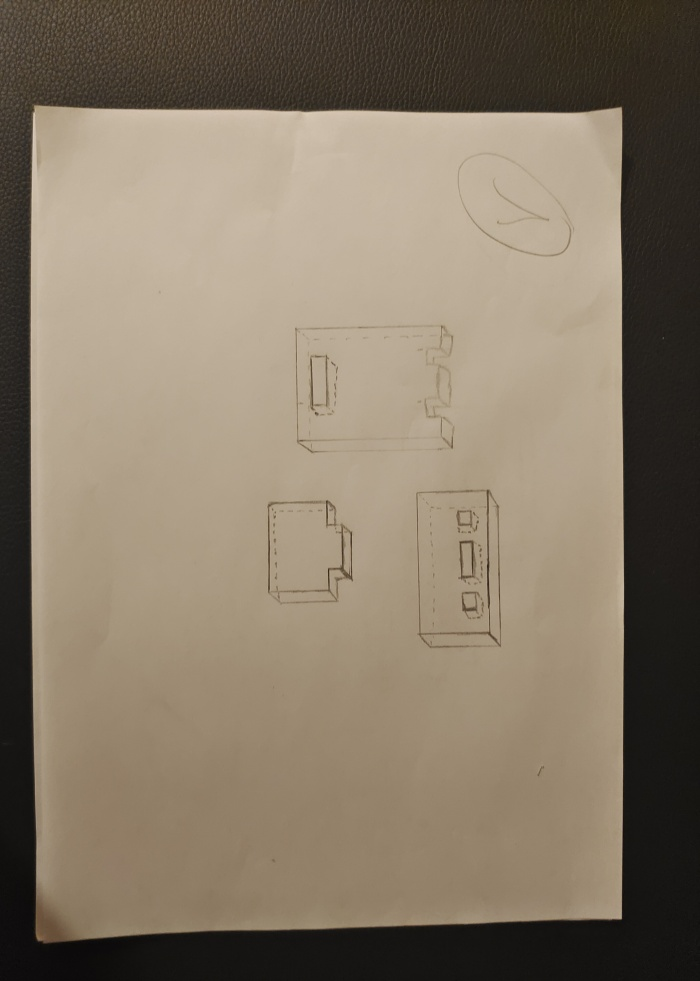 |

J'ai dessiné deux solutions et j'ai gardé la première. La seconde était moins stable, plus fragile, moins esthétique, et le téléphone avait tendance à tomber.

Le support retenu compte **3 pièces emboîtées** :
- **la plaque** (50 × 90 mm), posée à plat, sur laquelle repose le téléphone. Elle a **2 tenons** à un bout et une **fente** de 10 × 6 mm à l'autre ;
- **la pièce à 3 encoches** (80 × 30 mm), qui se dresse à l'arrière. Les tenons de la plaque s'y emboîtent, et le téléphone s'appuie contre elle ;
- **la cale** (17,7 × 17,7 mm), emboîtée dans la fente de la plaque. Elle forme la butée qui retient le bas du téléphone.

| Plaque | Pièce à 3 encoches | Cale |
|---|---|---|
| 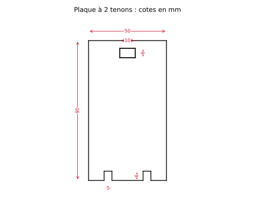 | 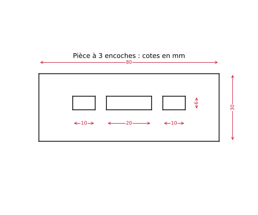 | 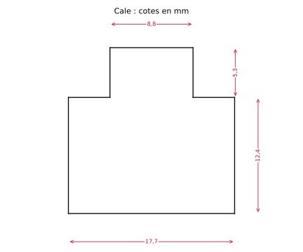 |

*Plans redessinés à partir de mes fichiers DXF (cotes en mm).*

**Modèle SolidWorks** : les pièces, puis l'assemblage avec le téléphone.

| | | |
|---|---|---|
| 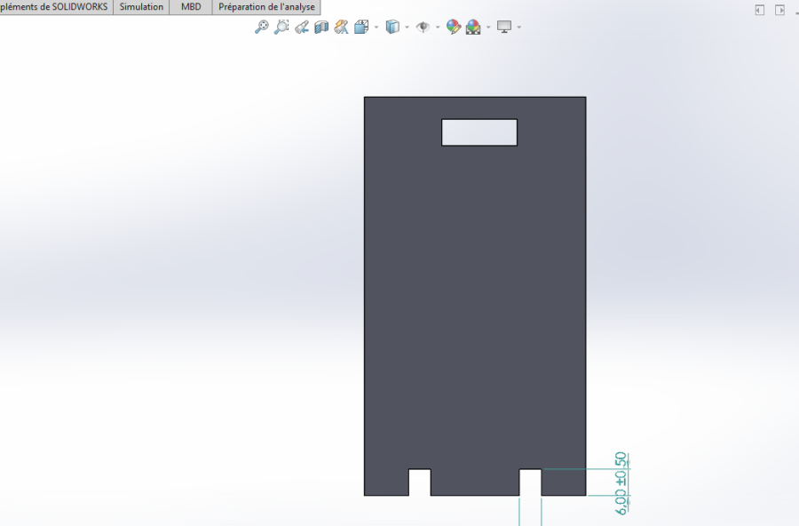 | 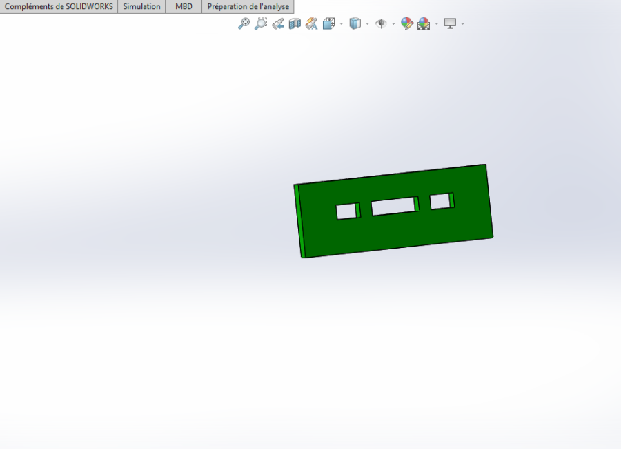 | 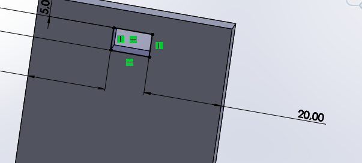 |
| 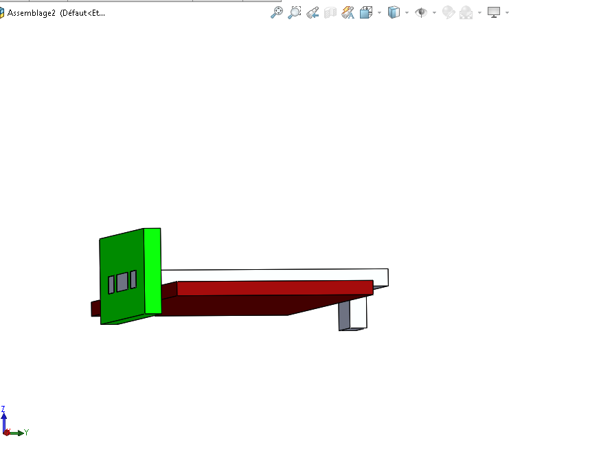 | 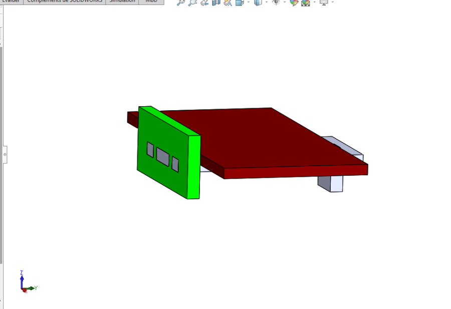 | |

### Maquette, puis découpe laser
J'ai d'abord validé les proportions avec une **maquette en carton** à l'échelle 1 :

| | | | |
|---|---|---|---|
| 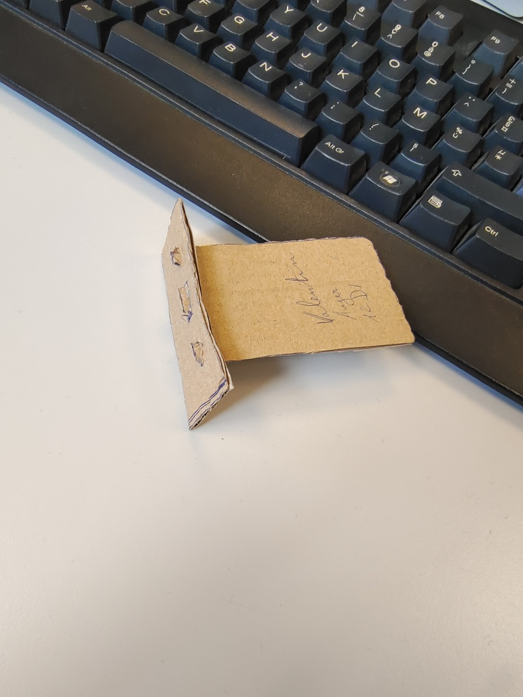 | 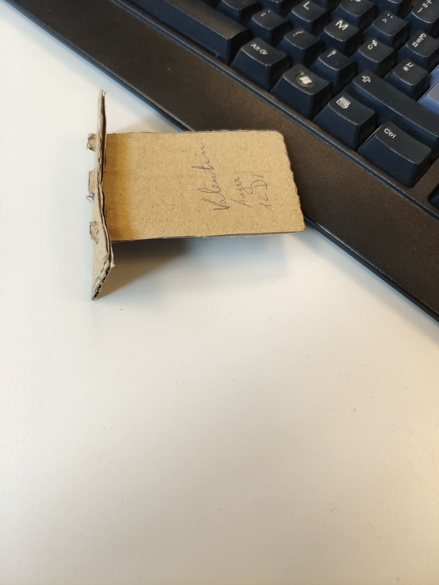 | 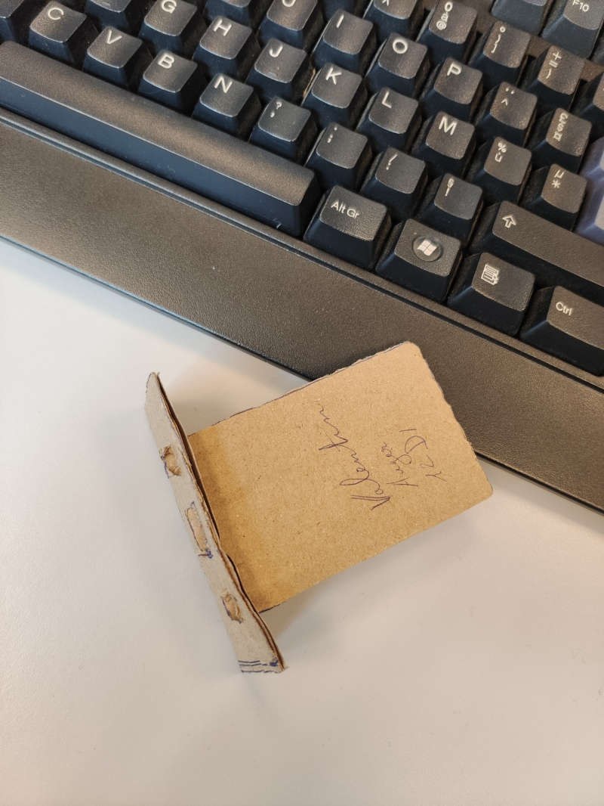 | 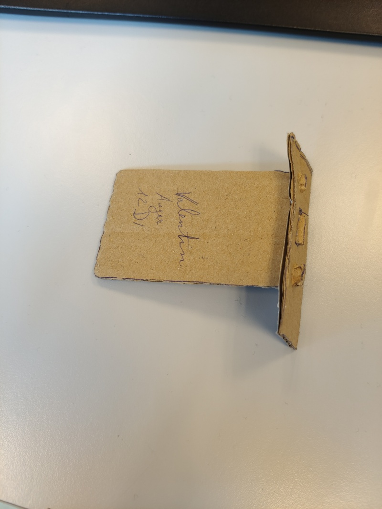 |

Au premier essai, le téléphone glissait. J'ai donc **ajouté la cale**, dans l'esquisse comme dans l'assemblage SolidWorks, pour qu'il ne glisse plus.

J'ai ensuite exporté chaque pièce en DXF ([`dxf/`](dxf)), puis je l'ai découpée au laser dans du **MDF**. J'ai retenu le MDF plutôt que le PMMA. Le PMMA (plexiglas) est cher, se raye facilement, résiste mal aux produits chimiques et se recycle mal. Le MDF, un composite de fibres de bois, est moins cher et plus facile à recycler.

| | | | |
|---|---|---|---|
| 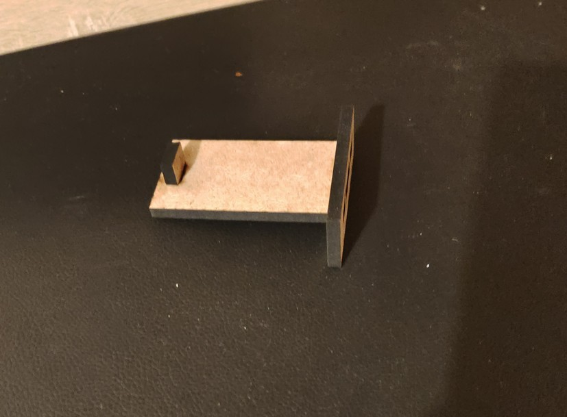 | 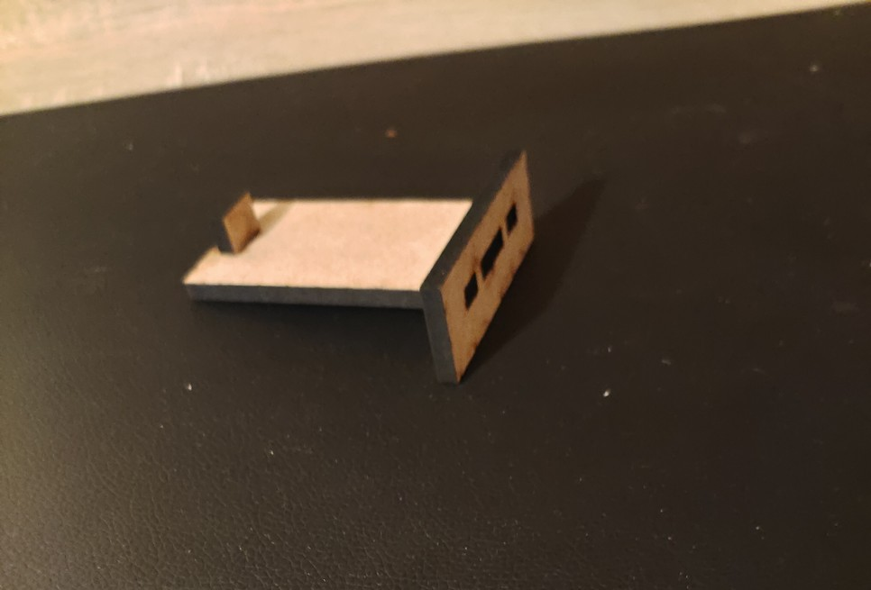 |  | 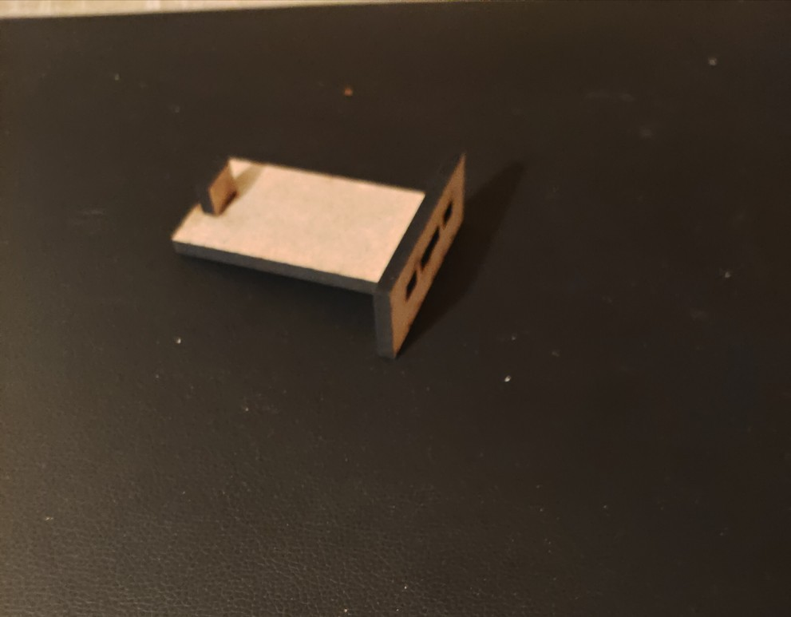 |

### Résultat
Le support s'assemble sans outil, sans vis ni colle, et tient le téléphone. Mon bilan de 2021 : un beau design et un support stable, mais un peu compliqué à assembler.

### Vérification en 2026
Avec les cotes exactes des DXF, j'ai refait les calculs qu'on fait avant de lancer une série.

1. **Jeu des encoches.** Les encoches de la pièce verticale mesurent **6 mm de haut** pour une plaque de 3 ou 4 mm d'épaisseur, soit **2 à 3 mm de jeu**. Les encoches de 10 mm reçoivent des tenons de 5 mm, soit **5 mm de jeu**. La fente de la plaque (10 × 6 mm) reçoit la cale (8,8 × 5,3 mm), soit environ 1 mm de jeu. Avec ces jeux, l'assemblage est facile à monter mais flotte un peu. Ça peut expliquer pourquoi le téléphone glissait au premier essai. Pour un emboîtement serré, il faut dessiner l'encoche à l'**épaisseur réelle mesurée** du panneau, et le tenon à la largeur de l'encoche.
2. **Largeur du trait de coupe.** Le laser enlève un trait d'environ **0,1 à 0,2 mm**. Chaque encoche s'élargit donc d'autant, et chaque tenon s'amincit d'autant. Sur un assemblage serré, il faut compenser : décaler le contour d'une demi-largeur de trait, ou découper d'abord une **pièce d'essai en peigne** (encoches de 2,8 / 2,9 / 3,0 / 3,1 mm) et garder celle qui tient.
3. **Stabilité.** La cale à l'avant de la plaque retient le bas du téléphone, mais le haut du téléphone s'appuie sur une pièce de **30 mm de haut** seulement, emboîtée par 2 tenons. Pour un grand smartphone, le centre de gravité passe haut au-dessus de cet appui, et une poussée sur l'écran fait pivoter l'ensemble autour des tenons. Une pièce arrière plus haute, ou un angle d'inclinaison fixé par une troisième pièce, rendraient le support plus rigide.
4. **Masse et encombrement face au cahier des charges.**
   - **Masse.** La surface totale des 3 pièces est de 6 925 mm². En MDF de 3 mm (masse volumique de 0,65 à 0,80 g/cm³), cela fait **13,5 à 16,6 g**, à la limite des 15 g autorisés. En 4 mm, on passe à 18 à 22 g, et en PMMA à 25 à 33 g.
   - **Encombrement.** La plaque mesure 90 mm de long, soit plus que les 80 × 50 mm d'emprise maximale si on les lit comme une emprise au sol.

   Pour respecter les deux contraintes, il faudrait raccourcir la plaque, ou l'évider.

### Contenu du dépôt
```
dxf/     plaque.dxf, piece-encoches.dxf, cale.dxf : fichiers de découpe laser (mm)
plans/   rendus cotés de chaque plan, en SVG et PNG
images/  croquis, captures SolidWorks, maquette carton, pièces découpées
```

---

## English

### Need
First-year **STI2D** project (French technology high-school track, November 2021): design a **simple smartphone stand** for a desk. The phone must be viewable at a good angle without sliding or falling, and the stand must be stable and look good. Constraints:
- 2 to 3 **interlocking** parts, with no screws, glue or bending;
- flat parts **laser-cut** from **3 or 4 mm MDF or PMMA**;
- maximum envelope 80 × 50 mm, height 50 mm, mass 15 g;
- designed in **SolidWorks**.

### Design
Three interlocking parts:
- **the plate** (50 × 90 mm), lying flat, with 2 tabs at one end and a 10 × 6 mm slot at the other;
- **the slotted part** (80 × 30 mm), standing at the back, which takes the tabs and supports the phone;
- **the stop** (17.7 × 17.7 mm), fitted in the plate's slot, which holds the bottom of the phone.

A full-size **cardboard mock-up** came first. Since the phone slid off, I added the stop, then cut the parts from **MDF** (cheaper and easier to recycle than PMMA). DXF files are in [`dxf/`](dxf) and dimensioned drawings in [`plans/`](plans).

### 2026 verification
1. **Slot clearance:** the 6 mm slots take a 3 or 4 mm plate (2 to 3 mm of play), and the 10 mm slots take 5 mm tabs (5 mm of play). That makes it easy to assemble but loose. Slots should be drawn at the measured board thickness.
2. **Kerf:** the laser removes about 0.1 to 0.2 mm, which widens slots and thins tabs. Offset the contour by half the kerf, or cut a test comb first.
3. **Stability:** the phone leans on a back part only 30 mm high, held by 2 tabs, so a push on the screen can rotate the assembly. A taller back part or a fixed angle would make it stiffer.
4. **Mass and envelope:** the parts total 6,925 mm². In 3 mm MDF that is 13.5 to 16.6 g, right at the 15 g limit, and the 90 mm plate exceeds an 80 × 50 mm footprint.
